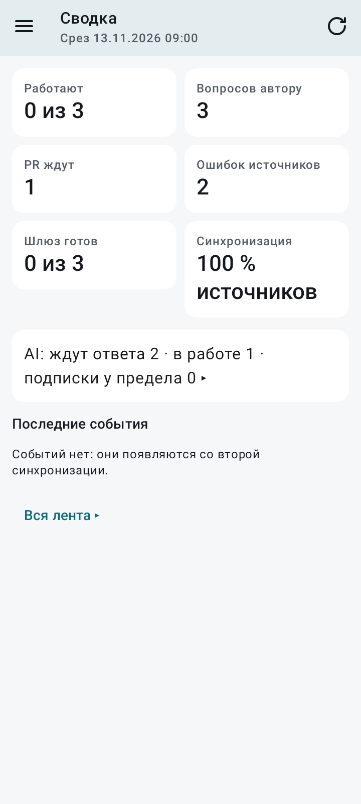
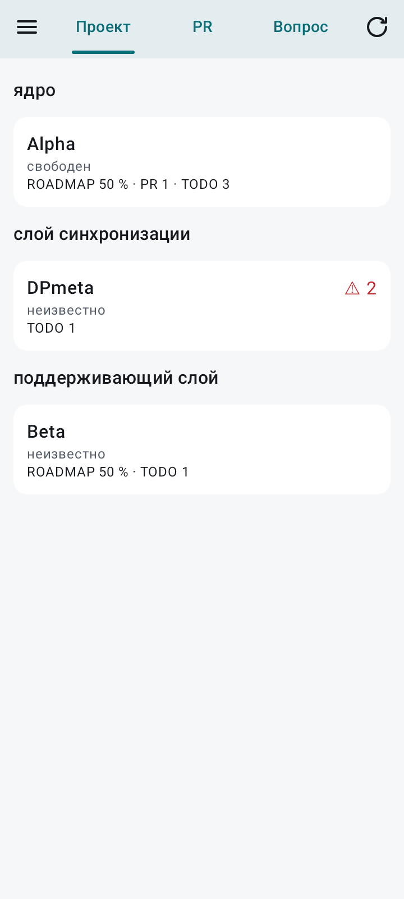
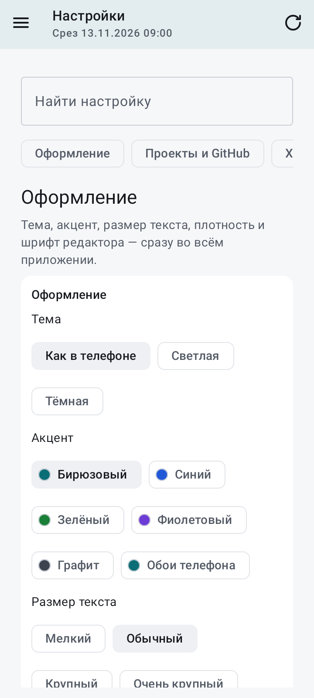
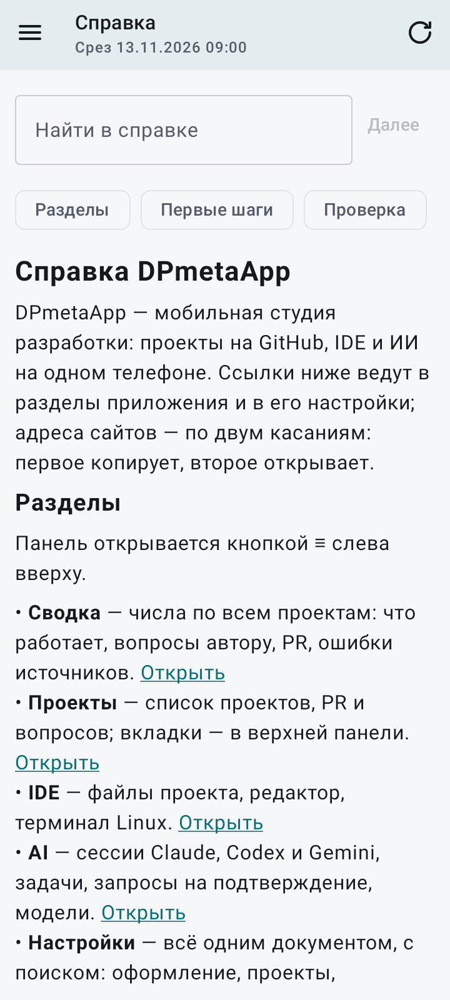
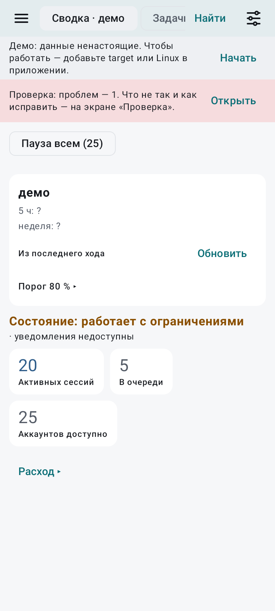
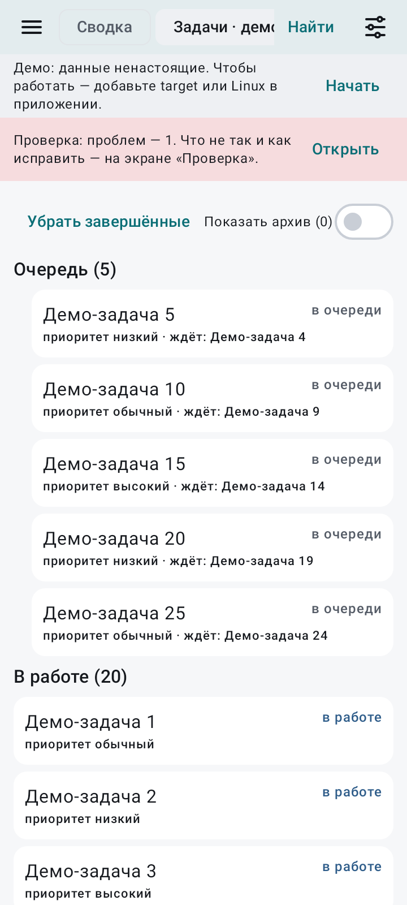

# DPmetaApp

Одно Android-приложение автора — единая среда его экосистемы: проекты и
ход разработки, сайт `dpsmpx.com`, аккаунты и сессии Claude, статистика
и графики. Системы активных репозиториев становятся подсистемами
приложения, а не внешними программами (D-27); до своего переноса о
проекте прав его репозиторий.

**Всё в одном (D-28).** Первая подсистема уже здесь: DP_AI_Orcestrator —
подсистема «AI», каталог [`dpai/`](dpai/README.md), с историей git. Её
ядро (`Outcome`, `Diagnostic`, `Clock`, `Secret`, JSON, журнал событий,
хранилище, одобрения) — ядро всего приложения, а её Android-оболочка —
первая форма приложения. Вторая — DPpass, клиент прокси и VPN, каталог
[`dppass/`](dppass/README.md), тоже с историей (D-30); пока у него свой
APK и своё ядро. Прежние репозитории DP_AI_Orcestrator и DPpass
заморожены: работа идёт только здесь.

## Как выглядит

Настоящие экраны приложения на синтетических данных — без телефона и без
данных автора: их снимает `tools/screenshots.sh` на JVM
([`docs/SCREENSHOTS.md`](docs/SCREENSHOTS.md)).

| Пульт: сводка | Пульт: проекты | Настройки |
|---|---|---|
|  |  |  |
| **Справка** | **«AI»: сводка (демо)** | **«AI»: задачи (демо)** |
|  |  |  |

## Что приложение умеет сейчас

Срез на 25 октября 2026. Что из этого ещё не проверено на телефоне —
разделы «На устройстве» в [`dpai/TODO.md`](dpai/TODO.md) и
[`dppass/TODO.md`](dppass/TODO.md).

### Подсистема «AI» — пульт сессий Claude Code

Подробно — [`dpai/README.md`](dpai/README.md).

- **Где идёт работа.** Execution targets: Termux на этом же телефоне
  (приложение само запускает его `sshd`), ПК с Linux или Windows по SSH
  — настройка одной командой из «Инструкции» (DP_AI_Orcestrator:D-52,
  DP_AI_Orcestrator:D-70). Ход Claude может идти на телефоне, а рабочее
  дерево, Git и проверка — на ПК (DP_AI_Orcestrator:D-50,
  DP_AI_Orcestrator:D-53). Ключи телефона входят на ПК только из частных
  сетей: дома — один Wi-Fi, вне дома — ПК на точке доступа телефона,
  интернет ПК — через раздачу туннеля DPpass (DP_AI_Orcestrator:D-68,
  DP_AI_Orcestrator:D-84). Вход в Claude — только формой Claude в слоте
  аккаунта, ключей API нет (DP_AI_Orcestrator:D-29).
- **Подписки и слоты.** Несколько подписок и слотов; загрузка окон «5 ч»
  и «неделя», порог «у предела». Задача, упёршаяся в предел подписки,
  переходит на слот другой подписки с запасом вместе с контекстом,
  перепиской и списком фоновых процессов; видно, кто её выполняет и кому
  она передавалась (DP_AI_Orcestrator:D-56, DP_AI_Orcestrator:D-57,
  DP_AI_Orcestrator:D-66, DP_AI_Orcestrator:D-67). Слот сам
  перепроверяет вход после сбоя сети (DP_AI_Orcestrator:D-58).
- **Задачи.** Создание с приоритетом, классом, моделью, усилием,
  пределом стоимости хода, ревью, областью и зависимостями (их можно
  менять до запуска); пауза, продолжение, отмена, повтор, «Запустить
  первой», ручная проверка, архив. Каждое действие — команда с ключом:
  повтор нажатия не делает второго действия (DP_AI_Orcestrator:D-42,
  DP_AI_Orcestrator:D-77).
- **Чат сессии.** Все сессии задачи — одной лентой: запросы, рассуждения
  и ответы модели с оформлением Markdown, события контура. Сообщение во
  время хода встаёт в очередь и уходит в ту же сессию после хода — ход и
  фоновые процессы не прерываются
  (DP_AI_Orcestrator:D-59…DP_AI_Orcestrator:D-62). «Перенести на слот» и
  «Перенести на другой слот», окно «Контекст» — что видел Claude в
  последнем ходе (DP_AI_Orcestrator:D-66, DP_AI_Orcestrator:D-77).
  События идущего хода приходят потоком, а не опросом
  (DP_AI_Orcestrator:D-76).
- **Git, проверка и ревью.** Рабочее дерево и ветка на задачу; «готово»
  модели — не завершение: проверка профиля, затем ревью кода и
  безопасности отдельными сессиями только для чтения
  (DP_AI_Orcestrator:D-73); изменения задачи — по файлам и текстом;
  слияние — только по ответу человека.
- **Сводка, поиск, расход.** Сводка — подписки, состояние и быстрые
  действия («Пауза всем», «Ждут человека»); глобальный поиск по задачам,
  сессиям, веткам, коммитам и событиям; расход по задаче и сессии —
  ходы, токены, стоимость.
- **Свой терминал.** Терминал к target по SSH внутри приложения:
  оболочка или интерактивный `claude` слота (DP_AI_Orcestrator:D-71).
  Своя Linux-среда в приложении (Alpine под proot,
  DP_AI_Orcestrator:D-75, DP_AI_Orcestrator:D-82) — в работе: среда и
  запуск процессов готовы, агент в процессе приложения — следующий шаг.
- **Запросы человеку, `dpai`, журнал.** Уведомления и окно с вариантами
  ответа (опасное — с подтверждением); команда `dpai` в Termux или на ПК
  — те же действия, что на экране (DP_AI_Orcestrator:D-47); журнал
  приложения и копия настроек — в «Загрузки»; восстановление после
  переустановки — одной командой в Termux (DP_AI_Orcestrator:D-54).

### DPpass — клиент прокси и VPN

Подробно — [`dppass/README.md`](dppass/README.md).

- **Туннель.** Ядро Xray в процессе приложения, проверка каждого сервера
  запросом через него (DPpass:D-24, DPpass:D-25, DPpass:D-32);
  постоянный VPN, плитка, смена сети — режим и проверка сети заново
  (DPpass:D-40, DPpass:D-67).
- **Подписки и импорт.** Подписки по HTTPS с автообновлением, имя —
  выбор пользователя; ссылки, документы и QR (камерой и с картинки)
  (DPpass:D-36, DPpass:D-39, DPpass:D-42, DPpass:D-53, DPpass:D-65,
  DPpass:D-71). Директивы поставщика без согласия не применяются
  (DPpass:D-11). Напоминание о конце подписки — будильником
  (DPpass:D-76).
- **Маршрутизация.** Своя политика: правила, DNS, приложения;
  отечественное — мимо туннеля по выбору; локальные сети — мимо туннеля
  (DPpass:D-38, DPpass:D-45). Режим сети по свежей проверке, пробы и
  ориентиры, разбиение ClientHello, сайты напрямую, «без сервера»
  (DPpass:D-60, DPpass:D-64, DPpass:D-68, DPpass:D-72, DPpass:D-73).
- **Раздача и учёт.** Раздача туннеля другим устройствам по Wi-Fi, USB и
  Bluetooth и подключение через другое устройство с DPpass, сопряжение
  по коду (DPpass:D-51, DPpass:D-55, DPpass:D-56); задержка, скорость и
  учёт трафика по сетям (DPpass:D-61, DPpass:D-70, DPpass:D-92).
- **Linux.** Оболочка для ПК с туннелем TUN: подписки, проверка сети,
  раздача на точке доступа ПК и подключение через устройство раздачи
  (DPpass:D-74, DPpass:D-77…DPpass:D-85).

### Ещё не начато

Остальное из D-01 — проекты экосистемы, ход разработки, сайт, статистика
и графики — приходит подсистемами в фазе B мастер-ТЗ (D-25, D-28); этапы
— [`ROADMAP/ROADMAP.md`](ROADMAP/ROADMAP.md).

## Что где

| Вопрос | Документ |
|---|---|
| что просил автор | [`docs/direction/REQUEST.md`](docs/direction/REQUEST.md) |
| что строится в 1.0 и как проверяется готовность | [`docs/direction/TECHNICAL_TASK.md`](docs/direction/TECHNICAL_TASK.md) |
| что решено и почему | [`docs/direction/DECISIONS.md`](docs/direction/DECISIONS.md) |
| как устроены репозиторий и сборка | [`docs/ARCHITECTURE.md`](docs/ARCHITECTURE.md) |
| этапы и их состояние | [`ROADMAP/ROADMAP.md`](ROADMAP/ROADMAP.md) |
| незаконченное и вопросы за автором | [`TODO.md`](TODO.md) |
| правила для сессий | [`CLAUDE.md`](CLAUDE.md) |
| подсистема «AI» и ядро: устройство, решения, план, проверки | [`dpai/README.md`](dpai/README.md), [`dpai/CLAUDE.md`](dpai/CLAUDE.md) |
| проверка «AI» на телефоне по шагам | [`dpai/docs/DEVICE_CHECK.md`](dpai/docs/DEVICE_CHECK.md) |
| подсистема DPpass: устройство, решения, план, проверки | [`dppass/README.md`](dppass/README.md), [`dppass/CLAUDE.md`](dppass/CLAUDE.md) |
| зачем каждое правило и откуда оно взято | [`docs/PROCESS.md`](docs/PROCESS.md) |
| происхождение чужого | [`docs/PROVENANCE.md`](docs/PROVENANCE.md) |

Нужна ли приложению официальная подпись разработчика — ТЗ, §12 (кратко:
для 1.0 — нет, нужен собственный ключ выпуска).

## Сборка и проверки

```sh
./gradlew build                     # из корня: ядро, подсистема «AI» и, при Android SDK, приложение
tools/check/run.sh                  # static: документы, процесс, секреты, ядро — секунды
tools/check/run.sh full             # и самотесты, проверки подсистемы dpai, ./gradlew build из корня; перед вливанием
tools/check/run.sh full --strict    # то же, но без JDK или Android SDK — ошибка; перед выпуском
tools/check/run.sh --write-status   # переписать блок состояния ниже из ROADMAP
cd dpai && tools/verify/run.sh full # подсистема «AI»: сборка, все тесты, при SDK — lint и API Android 30
cd dppass && tools/hostcheck/run.sh --quick   # DPpass: быстрые проверки; --full — перед вливанием
```

Нужны Python ≥ 3.11 и git; для сборки — JDK 21 (Gradle — через
wrapper); для приложения — Android SDK (`ANDROID_HOME` или
`local.properties`), без него собирается всё, кроме оболочки Android.
Сборки — только для устройств автора, в ветках сборок по платформе
(`apk_debug`, `linux_debug`, D-33); релиз подписывает автор своим ключом
(ТЗ, §12.4), APK нигде не публикуется (D-24). GitHub Actions не
используются.

## Состояние

<!-- status:begin -->
<!-- Строит tools/check/run.sh --write-status из ROADMAP/ROADMAP.md — руками не править. -->

Сделано этапов: **4 из 9**; текущий — **2. Данные экосистемы** (шагов: 9 из 10).

| Этап | Суть | Сложность | Шаги |
|---|---|---|---|
| 0 | Согласование ТЗ и процесс | М | 8 из 8 |
| 1 | Каркас сборки и ядро | Т | 6 из 6 |
| 2 | Данные экосистемы | Т | 9 из 10 |
| 3 | Интерфейс MVP | Т | 7 из 7 |
| 4 | Рабочие проекты и редактор | Т | 14 из 26 |
| 5 | Claude и действия | Т | 7 из 7 |
| 6 | Инструменты, проверка, сборка и запуск | Т | 8 из 13 |
| 7 | Отладка, канал к ПК и восстановление | Т | 1 из 9 |
| 8 | Выпуск 1.0.0 | С | 0 из 6 |
<!-- status:end -->

## Лицензия

Все права защищены — `LICENSE` (D-47): одна лицензия на весь репозиторий,
подсистемы тоже; стороннее — по своим лицензиям (`docs/PROVENANCE.md`).
